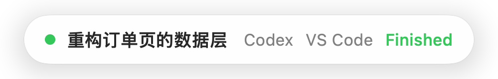

# AgentDone

极轻量的 macOS 菜单栏小工具：**同时开很多 AI 编码会话时，哪个跑完了、哪个在等你，一眼看见。**

支持 5 类：Claude Code · Codex · DeepSeek Harness · ZCode ·（可扩展）

- 常驻 **21 MB** 内存，无网络请求，全部本地
- 菜单栏一个 🔔 + 数字；完成瞬间顶部弹一枚胶囊 + 轻提示音
- 点一行 → 跳回那个 App（VS Code / iTerm / Terminal / Codex 桌面 / Harness / ZCode）并把该行消掉
- **Codex / DeepSeek Harness / ZCode 零配置**（直接读它们各自的本地会话数据）；Claude Code 只需合并 4 个 hook




## 它覆盖什么

| 场景 | 是否需要配置 | 说明 |
|---|---|---|
| Claude Code CLI（Terminal / iTerm / Warp / Ghostty / VS Code 集成终端） | 安装脚本自动写入 hooks | `Stop`→完成、`Notification`→需要你、`SessionEnd`→移除；宿主由 `TERM_PROGRAM` 判定 |
| Claude Code VS Code 扩展（`anthropic.claude-code`） | 同上（扩展跑的就是同一个 CLI，用户级 hooks 始终加载） | 宿主由 `CLAUDE_CODE_ENTRYPOINT=claude-vscode` 判定，比进程树更可靠 |
| Claude 桌面 App | 同上 | 宿主由 `CLAUDE_CODE_ENTRYPOINT=claude-desktop` 判定 |
| Codex CLI | 不需要 | 监听 `~/.codex/sessions/**/rollout-*.jsonl` 的 `task_complete`；`originator` 含 `cli` → 宿主显示"终端" |
| Codex VS Code 扩展（`openai.codex`） | 不需要 | 同上，扩展写同一份日志；`originator` 含 `vscode` → 宿主显示 VS Code |
| Codex 桌面 App（ChatGPT.app 内的 Codex） | 不需要 | 同上，`originator: Codex Desktop` / `codex_work_desktop` → 宿主显示"Codex 桌面" |
| DeepSeek Harness | 不需要 | 读 `~/.dsh/storages/session_projcache`，用 `turnBoundary.openTurnStartSeq` 判断回合是否结束 |
| ZCode（智谱 GLM 桌面 IDE） | 不需要 | 读 `~/.zcode/v2/tasks-index.sqlite`，`task_status` 由空变 `completed` 即为完成，`error` 记为"需要你" |
| **远程集群**（VS Code Remote-SSH / devspace 里的 Codex、Claude） | 菜单栏 → 设置 → 勾选主机 | 见下面「远程集群」一节 |

> 注意：`source` 和 `originator` 是两个维度 —— 桌面 App 写的日志里 `source` 也可能是 `vscode`，
> 所以宿主判定**以 `originator` 为准**（v0.2.1 修正，之前会把桌面会话误标成 VS Code）。

### 插件和 CLI 是同一个 Agent

VS Code 里的 Claude 插件**不自己实现 agent**，它启动的就是官方 CLI 二进制
（`~/.vscode/extensions/anthropic.claude-code-*/resources/native-binary/claude`）。
所以 hooks 是 CLI 级别的，**插件里跑同样会触发**，不需要为插件单独配置。
插件唯一的区别是它会给 CLI 设 `CLAUDE_CODE_ENTRYPOINT=claude-vscode`，我们用它来显示"VS Code"。

Codex 插件同理：它写的是同一份 `~/.codex/sessions/**/rollout-*.jsonl`。

### 列表上显示的是会话名，不是目录名

每一行的大标题是**这个会话自己的名字**，副标题才是 `项目 · Agent · 宿主 · 状态`。
名字从各自的来源取：

| Agent | 会话名来源 |
|---|---|
| Claude Code | transcript 里的 `custom-title` 行（就是你 `/rename` 或自动生成的标题），取最后一条 |
| Codex | rollout 里第一条**真实**用户输入（自动跳过 `<environment_context>` 这类系统包装） |
| DeepSeek Harness | `record.rows.title.val`（DSH 自己起的标题） |
| ZCode | `tasks.title` |

取不到名字时自动退回显示目录名，所以不会出现空行。

### 列表里只有"有结果"的会话

正在跑的会话**不占列表位置**（也不响铃、不计数）—— 否则你每开一个对话就多一行，
挂着永远不消失。跑完了才会出现，点一下就消失。

徽标数字 = 「需要你」+「已完成」的数量，运行中的不算。

### 会话结束时发生了什么

- 覆盖它的是三件事：`Stop`（完成）、`Notification`（需要你）、`SessionEnd`（会话关闭）
- `SessionEnd` 只在**还没有结论**（运行中）时才删掉那一行
- 已经有结果（完成/需要你）的，即使会话关闭也**保留** —— 否则像 `claude -p "..."` 这种一次跑完立刻退出的场景，
  完成和关闭只隔几十毫秒，提醒会被立刻抹掉（v0.2.1 修的就是这个）

### 宿主怎么认出来的

按优先级：`CLAUDE_CODE_ENTRYPOINT`（扩展/桌面自己声明）→ `TERM_PROGRAM`（集成终端）→ 进程祖先链里的 `.app` → `__CFBundleIdentifier` → 兜底"终端"。
所以同一个 CLI，在 VS Code 扩展里跑、在集成终端里跑、在 iTerm 里跑，跳转目标都不会错。

## 远程集群（VS Code Remote-SSH / devspace）

如果你的 VS Code 是 `Remote-SSH` / devspace 连到集群，**扩展和 CLI 都跑在远端**，
日志和 hooks 也都在远端 —— 本机监听是看不到的。AgentDone 用一条常驻 ssh 流解决：

```bash
菜单栏图标 → 设置 → 远程（SSH）
  · 勾选主机（列表读的是 VS Code 的 remote.SSH.configFile，默认 ~/.ssh/config）
  · 测试连接 / 安装 Claude hooks
```


它是怎么工作的：

- **Codex（远端）**：远端跑一小段 python（从 ssh 的 stdin 送进去），增量读
  `~/.codex/sessions/**/rollout-*.jsonl` 的新增字节，只把 `task_started` / `task_complete` 两行发回来
- **Claude（远端）**：设置页往远端 `~/.claude/settings.json` 合并 4 个 hook，命令是一条内联 `python3 -c`，
  **远端不落地任何脚本文件**；hook 把事件追加到 `~/.agentdone/spool.jsonl`，同一段 python 读它
- **摘要**：远端 transcript 的解析也在远端做，只回传最后一条助手消息的前 80 字

三条硬约束（刻意这么设计的）：

1. **不下载任何文件** —— 全程只传事件行（每轮几百字节），没有 `scp`/`rsync` 往回拉
2. **不改远端脚本目录** —— 安装 hooks 时脚本文本经 stdin 送入，远端只多一个 `~/.agentdone/spool.jsonl`
3. **可干净撤销** —— 移除时把你的 settings 还原成安装前的样子（JSON 归一化后逐字节一致，已实测）

细节：

- 设置存在 `~/.agentdone/config.json`；`~/.agentdone/remotes` 可以手写一行一个主机（优先级更高）
- 打开「自动跟随 VS Code 当前远程连接」就不用管主机名 —— devspace 的 Pod 名会变，它每次自动跟上
- 远端 home 是持久盘时（比如 `/root/.claude` 软链到挂载盘），hooks 装一次能跨 Pod 存活
- 远端需要 `python3`（一般 Linux 都有）和免密 ssh（能 `ssh <host> true` 不弹密码即可）

## 安装

**不需要 Xcode、不需要 python、不需要 Homebrew。** 仓库自带 Universal 二进制
（`vendor/`，arm64 + x86_64），直接装：

```bash
cd agentdone
./install.sh
```

要求：macOS 12 或更高（Intel / Apple Silicon 都可以）。

脚本会：编译 App → 装到 `~/Applications/AgentDone.app` → 装 hook 到 `~/.agentdone/` →
把 4 个 hook 合并进 `~/.claude/settings.json`（先备份，保留你已有的其它 hook）→
注册登录自启（`~/Library/LaunchAgents/dev.agentdone.app.plist`）。

想把整个工具发给别人：**把整个 `agentdone/` 文件夹（含 `vendor/`）拷过去**，对方跑 `./install.sh` 就行。
从网上下载/微信传的文件会带 quarantine 标记，安装脚本已自动 `xattr -cr` 清掉。

**修改源码后重新生成 `vendor/`（只有开发者需要）：**

```bash
./build.sh      # 生成 arm64 + x86_64 的 Universal 二进制
```

想先看看效果、不写任何配置：

```bash
./build/AgentDone            # 直接前台跑，菜单栏出现图标
~/.agentdone/agentdone-hook demo done          # 手动触发一条“完成”
~/.agentdone/agentdone-hook --status           # 以 JSON 查看当前状态
```

## 使用

- **点菜单栏图标**：打开列表，按「需要你 → 已完成 → 运行中」排序
- **点某一行**：激活对应 App（VS Code 会用该项目的目录把窗口唤到前台），并从列表移除
- **清除**：清掉已完成的；**静音**：不再弹胶囊和响铃（列表照常更新）
- 列表里超过 6 小时的条目自动清理

## 卸载

```bash
./uninstall.sh
```

会把 App、hook、登录项删掉，并从 `~/.claude/settings.json` 里摘掉自己的 hook（其它 hook 原样保留）。

## 结构

```
AgentDone.swift             菜单栏 App（单文件，AppKit + SwiftUI，无第三方依赖）
bin/agentdone-hook.swift    采集端：Claude hook 入口 / Codex notify / --status / --install-hooks
remote/remote_watch.py      远端监听：增量读集群上的 Codex 日志 + Claude 事件，吐 NDJSON
remote/install_hooks.py     远端 hooks 安装/移除（经 ssh stdin 送入，不落地）
vendor/                     预编译 Universal 二进制（安装时优先使用）
build.sh                    重新生成 vendor/（开发者用）
install.sh                  安装 + 合并配置 + 登录自启（零依赖）
uninstall.sh                反向清理
docs/*.png                  界面预览（离屏渲染，非截屏）
```

## 分发 / 便携性

| 项 | 情况 |
|---|---|
| 架构 | Universal（arm64 + x86_64），Intel Mac 也能跑 |
| 系统版本 | macOS 12+ |
| 运行时依赖 | 无（不需要 Xcode / python3 / node / brew） |
| 网络 | 完全不联网，也不调用任何模型 API |
| 单实例 | 已有实例在跑时，新实例自动退出 |
| 安装体积 | App 约 780 KB，整个项目约 1.2 MB |

## 注意

- hook 走 `unix socket`（`/tmp/agentdone-<uid>.sock`，权限 0600），不监听 TCP 端口
- hook 里任何异常都 `exit 0`，不会卡住或影响 Claude Code / Codex
- 若你之前用 `codex notify` 接过别的工具，本工具**不会**改动你的 `~/.codex/config.toml`
- 首次安装后需要新开一个 Claude Code 会话，hook 才会被读取
