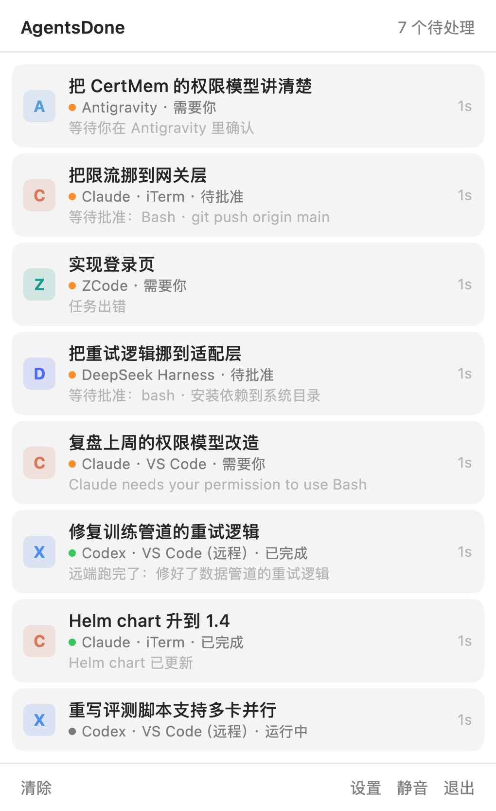
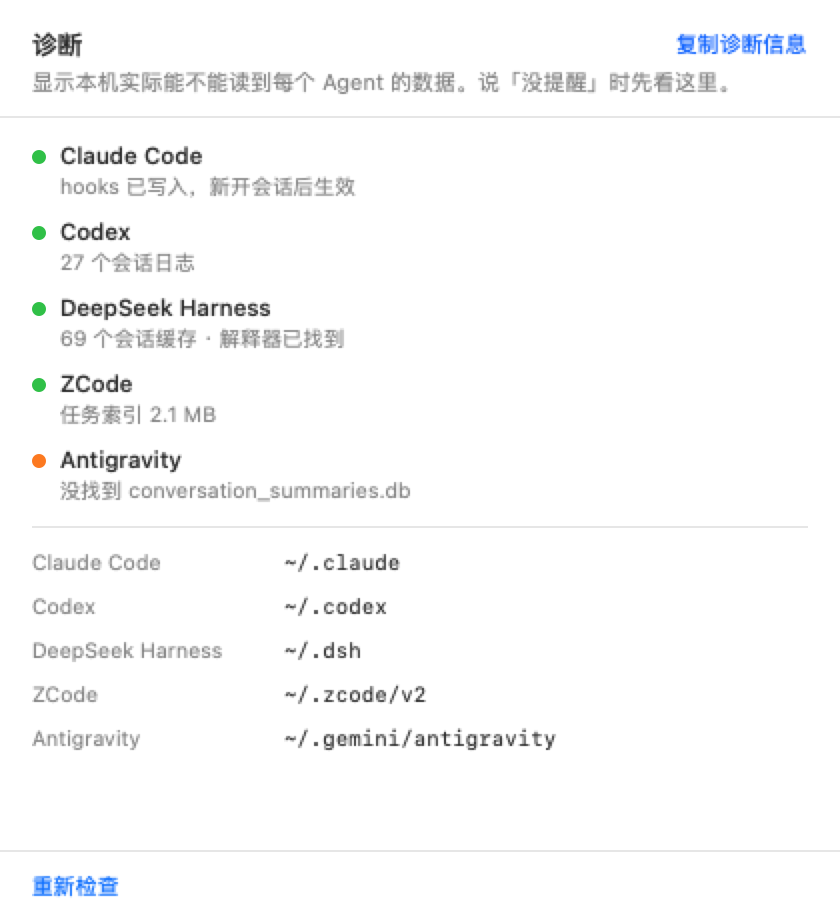

# AgentsDone

**中文** · [English](README.en.md)

极轻量的 macOS 菜单栏小工具：**同时开很多 AI 编码会话时，哪个跑完了、哪个在等你，一眼看见。**

不用切窗口挨个看，也不用给每个工具单独配一遍。



## 支持什么

| Agent | 怎么知道状态 | 要配置吗 |
|---|---|---|
| **Claude Code** | 6 个 hook（Stop / Notification / PermissionRequest / SessionStart / PostToolUse / SessionEnd） | 安装脚本自动合并 |
| **Codex**（CLI / VS Code 扩展 / 桌面） | 读 `~/.codex` 的会话日志 | 不用 |
| **DeepSeek Harness** | 读 `~/.dsh` 的会话缓存和日志 | 不用 |
| **ZCode** | 读 `~/.zcode` 的任务索引 | 不用 |
| **Antigravity** | 读 `~/.gemini/antigravity` 的会话库 | 不用 |

三种状态：

- **已完成** —— 跑完了，响一声 + 顶部弹一枚胶囊
- **待批准 / 需要你** —— 它在等你点同意、等你回话，或任务出错
- **运行中** —— 正在跑，安静地列在下面

点任意一行 → 跳回那个 App（VS Code / iTerm / Terminal / Codex / Harness / ZCode / Antigravity）并把该行消掉；
点弹出的浮窗也能跳回去。几个会话同时完成时，浮窗会排队依次出现，不会互相盖掉。


没有会话时：


## 安装

| 项 | 要求 |
|---|---|
| 系统 | macOS 12 Monterey 或更高 |
| 芯片 | Apple Silicon / Intel 都行（Universal 二进制） |
| 依赖 | **无**。不需要 Xcode、python、Homebrew、Node |
| 授权 | 不需要辅助功能、不需要通知权限 |
| 磁盘 / 内存 | 约 2.5 MB / 常驻约 37 MB |

**方式一：下载即用**（不需要终端）

从 [Releases](https://github.com/Watchman232/AgentsDone/releases/latest) 下载 `AgentsDone-<版本>.zip`，
解压后把 `AgentsDone.app` 拖进「应用程序」。第一次打开请**右键 → 打开**；macOS 15 之后右键打开已被移除，
去「系统设置 → 隐私与安全性」点「仍要打开」即可（App 未做 Apple 公证）。
Codex / DeepSeek Harness / ZCode / Antigravity 这样就够用了。

**方式二：脚本安装**（推荐，连 Claude Code 一起提醒）

Claude Code 的完成/审批事件只能靠 hook 拿到，所以要让 Claude 也提醒就得走脚本：

```bash
git clone https://github.com/Watchman232/AgentsDone.git
cd AgentsDone
./install.sh
```

没有 git 就网页右上 **Code → Download ZIP**，解压后进目录跑 `./install.sh`（脚本会自己清掉 quarantine 标记）。

装完先点 🔔 → 设置 → 右上角「试一下提醒」，会依次弹出两条示例，确认声音和浮窗正常。

装完你会看到：菜单栏多一个 🔔、`~/Applications/AgentsDone.app`、`~/.agentsdone/`（采集端），
以及登录自启（`~/Library/LaunchAgents/dev.agentsdone.app.plist`，意外退出会被自动拉起）。

脚本只做四件事：装 App → 装采集端 → 合并 hooks 进 `~/.claude/settings.json`（先备份，保留你原有的）→ 注册登录自启。
**全程不联网、不下载、不装任何依赖。**

卸载：`./uninstall.sh`

## 用起来

- 点 🔔 打开列表，点某一行跳回去；也可以按 **Option+Command+A** 直接打开
- 菜单里可以「静音」（不发提示音）、「清除」（清空列表）、「退出」
- 设置里能换提示音、静音 30 分钟、关掉「跟随 VS Code 当前远程连接」、添加远端主机、看数据目录
- 锁屏时不弹窗也不响，会话照样进列表，解锁后看得到

### 完全离线吗

是。不发遥测、不调用任何模型 API，代码里没有任何 HTTP 请求；数据全部来自本机文件，
Claude 的事件走 unix socket（`/tmp/agentsdone-<uid>.sock`，权限 0600），不监听 TCP 端口。

唯一的网络行为是**可选**功能「远端集群」：你在设置里勾选主机后才会 `ssh` 过去读日志，不配就完全不联网。

## 远端集群（可选）

VS Code Remote-SSH 或者直接连开发机跑 Codex/Claude 时，本机 App 也能收到那边的完成提醒：

菜单栏 → 设置 → 勾选主机 → 「安装 Claude hooks」。
只增量读远端的会话日志（每轮几百字节），不下载任何文件，脚本经 ssh stdin 送入、不落盘。


## 配置（通常不用）

五个 Agent 都按各自的默认位置找数据。换过盘、用过便携版、或远端目录不标准时，改
`~/.agentsdone/config.json`（设置页里有「打开配置文件」）：

```json
{
  "paths": { "codex": "~/codex-home", "dsh": "/Volumes/Data/dsh" },
  "hosts": [{ "host": "gpu-box", "enabled": true,
              "paths": { "codex": "~/work/.codex" } }]
}
```

- 支持 `~`，没写的键用默认值；改完 3 秒内自动生效，不用重启
- 路径写错不会报错，那个 Agent 静默不出现
- 看当前实际读了哪里：`~/Applications/AgentsDone.app/Contents/MacOS/AgentsDone --paths`

DSH 的审批提醒要借 DSH 桌面版自带的引擎解压它的 zstd 日志，装在 `/Applications` 或
`~/Applications` 会自动找到；装在别处就配 `dshNode` 指过去（找不到只影响这一项提醒）。

<details>
<summary>环境变量（测试/多实例用，日常不用管）</summary>

`AGENTSDONE_CONFIG_DIR` · `AGENTSDONE_HOME` · `AGENTSDONE_SOCK` · `PREFIX`（安装目录）
· `AGENTSDONE_CLAUDE_ROOT` · `CODEX_HOME` / `AGENTSDONE_CODEX_ROOT` · `AGENTSDONE_DSH_HOME` /
`AGENTSDONE_DSH_ROOT` / `AGENTSDONE_DSH_LOGS` / `AGENTSDONE_DSH_NODE` · `AGENTSDONE_ZCODE_ROOT`
· `AGENTSDONE_ANTIGRAVITY_ROOT` · `AGENTSDONE_REMOTE=0`（关远端） · `AGENTSDONE_NO_LAUNCH=1`

</details>

## 出问题先看诊断

点 🔔 → 设置 → 「数据目录」旁的 **诊断**，能看到每个 Agent 到底读不读得到数据：



右上角「复制诊断信息」可以一键贴出来；命令行也能跑：

```bash
~/Applications/AgentsDone.app/Contents/MacOS/AgentsDone --diagnose
```

## 注意

- hook 里任何异常都 `exit 0`，不会卡住或影响 Claude Code / Codex
- 不会改你的 `~/.codex/config.toml`；如果你之前用 `codex notify` 接过别的工具，原样保留
- 首次安装后需要**新开**一个 Claude Code 会话，hook 才会被读取
- 源码只有两个 Swift 文件（`AgentsDone.swift`、`bin/agentsdone-hook.swift`），无第三方依赖；
  改完跑 `./build.sh` 重新生成 `vendor/`

## 协议

MIT，见 [LICENSE](LICENSE)。用、改、商用、二开都行，保留版权声明即可。
