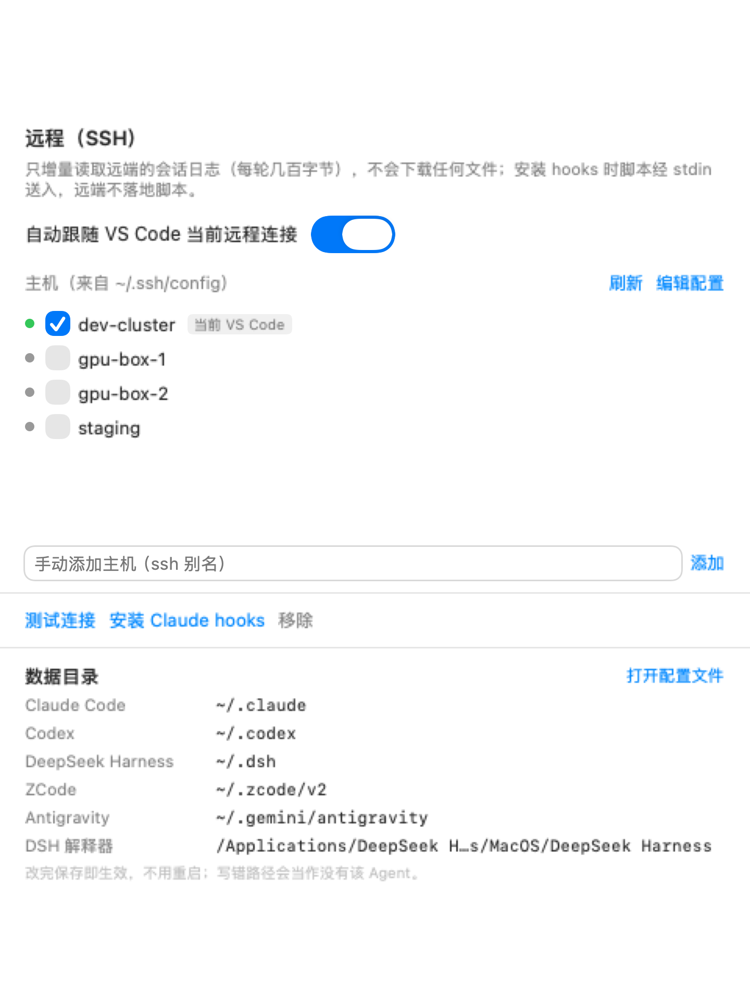

# AgentDone

极轻量的 macOS 菜单栏小工具：**同时开很多 AI 编码会话时，哪个跑完了、哪个在等你，一眼看见。**

支持 Claude Code · Codex · DeepSeek Harness · ZCode · Antigravity
（都是读各自 App 的本地会话数据，不联网、不调模型）

- 常驻 **21 MB** 内存，无网络请求，全部本地
- 菜单栏一个 🔔 + 数字；完成瞬间顶部弹一枚胶囊 + 轻提示音
- 点一行 → 跳回那个 App（VS Code / iTerm / Terminal / Codex 桌面 / Harness / ZCode）并把该行消掉
- **Codex / DeepSeek Harness / ZCode 零配置**（直接读它们各自的本地会话数据）；Claude Code 只需合并 6 个 hook


没有会话时是这样：


## 它覆盖什么

| 场景 | 是否需要配置 | 说明 |
|---|---|---|
| Claude Code CLI（Terminal / iTerm / Warp / Ghostty / VS Code 集成终端） | 安装脚本自动写入 hooks | `Stop`→完成、`PermissionRequest`→需要你（审批弹窗）、`PostToolUse`→运行中、`SessionEnd`→移除；宿主由 `TERM_PROGRAM` 判定 |
| Claude Code VS Code 扩展（`anthropic.claude-code`） | 同上（扩展跑的就是同一个 CLI，用户级 hooks 始终加载） | 宿主由 `CLAUDE_CODE_ENTRYPOINT=claude-vscode` 判定，比进程树更可靠 |
| Claude 桌面 App | 同上 | 宿主由 `CLAUDE_CODE_ENTRYPOINT=claude-desktop` 判定 |
| Codex CLI | 不需要 | 监听 `~/.codex/sessions/**/rollout-*.jsonl` 的 `task_complete`；`originator` 含 `cli` → 宿主显示"终端" |
| Codex VS Code 扩展（`openai.codex`） | 不需要 | 同上，扩展写同一份日志；`originator` 含 `vscode` → 宿主显示 VS Code |
| Codex 桌面 App（ChatGPT.app 内的 Codex） | 不需要 | 同上，`originator: Codex Desktop` / `codex_work_desktop` → 宿主显示"Codex 桌面" |
| DeepSeek Harness | 不需要 | 读 `~/.dsh/storages/session_projcache` 判断回合是否结束；审批读 `~/.dsh/sessions/**/session.v4.jsonl.zstd` 的 `approval/asked`（见下） |
| Antigravity（Google 的 agent IDE） | 不需要 | 读 `~/.gemini/antigravity`：`conversation_summaries.db` 给标题和运行状态，`conversations/<id>.db` 的 `steps.status` 给细状态（`WAITING` 就是等你确认） |
| ZCode（智谱 GLM 桌面 IDE） | 不需要 | 读 `~/.zcode/v2/tasks-index.sqlite`，`task_status` 由空变 `completed` 即为完成，`error` 记为"需要你" |
| **远程集群**（VS Code Remote-SSH / devspace 里的 Codex、Claude） | 菜单栏 → 设置 → 勾选主机 | 见下面「远程集群」一节 |

> 注意：`source` 和 `originator` 是两个维度 —— 桌面 App 写的日志里 `source` 也可能是 `vscode`，
> 所以宿主判定**以 `originator` 为准**（v0.2.1 修正，之前会把桌面会话误标成 VS Code）。

### 插件和 CLI 是同一个 Agent

VS Code 里的 Claude 插件**不自己实现 agent**，它启动的就是官方 CLI 二进制
（`~/.vscode/extensions/anthropic.claude-code-*/resources/native-binary/claude`）。
所以 hooks 是 CLI 级别的，**插件里跑同样会触发**，不需要为插件单独配置。
插件唯一的区别是它会给 CLI 设 `CLAUDE_CODE_ENTRYPOINT=claude-vscode`，我们用它来显示"VS Code"。

Codex 插件同理：它写的是同一份 `~/.codex/sessions/**/rollout-*.jsonl`。

### 列表上显示的是会话名，不是目录名

每一行的大标题是**这个会话自己的名字**，副标题才是 `项目 · Agent · 宿主 · 状态`。
名字从各自的来源取：

| Agent | 会话名来源 |
|---|---|
| Claude Code | transcript 里的 `custom-title` 行（就是你 `/rename` 或自动生成的标题），取最后一条 |
| Codex | `~/.codex/state_*.sqlite` 的 `threads.title`（**就是 VS Code 扩展里显示的名字**，会话被重命名后也会跟着更新）；查不到再退回 rollout 里第一条真实用户输入 |
| DeepSeek Harness | `record.rows.title.val`（DSH 自己起的标题） |
| ZCode | `tasks.title` |

取不到名字时自动退回显示目录名，所以不会出现空行。

> Codex 扩展常把「引用别的会话」作为首条消息，原文长这样：
> `[Chat thread](codex://threads/01a1f256-…) 查看这个会话的本地历史…`
> 直接取就会在列表里显示一串 UUID。现在会把这类链接剥掉，只留你真正写的那句话。

### 已经跑起来的会话也会出现

App 启动（或远端连上）时，如果某个 Codex 会话正跑到一半，它会立刻以「运行中」出现在列表里 ——
哪怕这一轮还没结束。做法是启动打底时从日志尾部推断状态，只有"进行中"才补发
（`working` 不响铃不弹窗）；已经结束的不会补发，避免一启动就被历史会话刷屏。

### 列表里有什么

**所有会话都显示**，每行带状态：

| 状态 | 圆点 | 出现时机 |
|---|---|---|
| 运行中 | 灰 | 会话正在跑（含刚开的对话） |
| 已完成 | 绿 | 这一轮跑完了 |
| 待批准 / 待回答 / 待授权 / 待确认 / 需要你 | 橙 | 等你动手（批准命令、回答问题、任务出错） |

排序固定是「等你动手」→「已完成」→「运行中」，每类内部按时间新到旧。
顶部数字 = 待处理数量（待批准/待回答/需要你 + 已完成），也就是徽标上的数字，运行中的不算。

**只有跑完和需要你才响铃/浮窗**，运行中静默 —— 不然每开一个会话都被打扰。
超过 6 小时没有任何动静的会话会自动清掉（运行中的也算），不会越堆越多。

### Antigravity 的三种状态怎么来的

| 字段 | 位置 | 用途 |
|---|---|---|
| `conversation_summaries.title` | `conversation_summaries.db` | 会话名（就是 IDE 里显示的那个） |
| `conversation_summaries.status` | 同上 | `RUNNING`/`BUSY` → 运行中；`IDLE` → 已结束 |
| `steps.status`（最后一步） | `conversations/<id>.db` | `WAITING(9)` → 待确认、`ERROR(7)` → 出错、`DONE(3)` → 完成 |
| `conversations_fts.agent_body` | `conversation_summaries.db` | 最后一轮回复的末句，做摘要 |

这些数字是 protobuf 枚举，从 App 里的 `language_server` 二进制按
`EnumValueDescriptorProto`（名字后紧跟 `0x10 <编号>`）解出来的：
`1 PENDING / 2 RUNNING / 3 DONE / 6 CANCELED / 7 ERROR / 8 GENERATING / 9 WAITING / 11 QUEUED / 12 INTERRUPTED`。

### 会话结束时发生了什么

- 覆盖它的是这几件事：`Stop`（完成）、`PermissionRequest` / `Notification`（需要你）、`PostToolUse`（批准后继续跑）、`SessionEnd`（会话关闭）
- `SessionEnd` 只在**还没有结论**（运行中）时才删掉那一行
- 已经有结果（完成/需要你）的，即使会话关闭也**保留** —— 否则像 `claude -p "..."` 这种一次跑完立刻退出的场景，
  完成和关闭只隔几十毫秒，提醒会被立刻抹掉（v0.2.1 修的就是这个）

### 宿主怎么认出来的

按优先级：`CLAUDE_CODE_ENTRYPOINT`（扩展/桌面自己声明）→ `TERM_PROGRAM`（集成终端）→ 进程祖先链里的 `.app` → `__CFBundleIdentifier` → 兜底"终端"。
所以同一个 CLI，在 VS Code 扩展里跑、在集成终端里跑、在 iTerm 里跑，跳转目标都不会错。

## 等你批准时也会提醒

Claude Code 需要你批准某个操作（比如 `git push`、写工作区外的文件）时会弹出审批框，
这时 AgentDone 会立刻亮起"需要你"，摘要直接写清楚要批什么：

```
等待批准：Bash · git push origin main
等待批准：Write · config.yaml
```

实现上用的是 `PermissionRequest` hook（审批弹窗一出现就触发，不用等 `Notification` 那几秒），
批准后 `PostToolUse` 立刻把它翻回"运行中"，所以那一行会自己消失，不会一直挂着。

**Codex 也有**（读 rollout 里的审批事件），剩下两家没有：

| Agent | 判断依据 | 备注 |
|---|---|---|
| Codex | rollout 里的 `exec_approval_request` / `apply_patch_approval_request` / `request_user_input` / `request_permissions` 事件 | 需要 **不是** full access 模式才会产生（`approval_policy` 为 `on-request` 等）；Plan 模式提问不受此限 |
| DeepSeek Harness | ❌ | `approvalState` 投影只存审批策略和"轮次是否打开"，待批请求只在运行时视图里，不落盘；完整会话日志是 zstd 压缩 |
| ZCode | ❌ | tasks 表只有任务状态（跑完/出错），没有审批态 |

对最后两家，卡在审批时它们只是"日志不再增长"，AgentDone 看到的就是一直在跑 —— 也就不会提醒。

Codex 的摘要长这样（批准后 `exec_command_begin` / `patch_apply_begin` 一到就翻回运行中）：

```
等待批准：git push origin main
等待批准：修改 /user/me/mf-duplexDemo/config
等待回答：要我用 4 卡还是 8 卡跑这次训练？
```

### DeepSeek Harness 的审批

DSH 把审批写进会话日志：`approval/asked`（含 `toolName` + `reason`）和 `approval/decided`。
所以它也能提醒 —— 你在面板里会看到「待批准 · 等待批准：bash · <原因>」。

这份日志是 **zstd 压缩、每事件一帧**，Swift 没有 zstd，所以借 DSH 桌面版自带的
Electron 当 node 用（`ELECTRON_RUN_AS_NODE=1`）来解，一次调用约 60ms；
并且**只读新增字节、只解新帧**，不会把几 MB 的日志整个解一遍。

前提：DSH 桌面版装在 `/Applications`（或 `~/Applications`）。装在别处就配 `dshNode`，
或用环境变量 `AGENTDONE_DSH_NODE`。找不到只是不做审批提醒，其它照常。

## 远程集群（VS Code Remote-SSH / devspace）

如果你的 VS Code 是 `Remote-SSH` / devspace 连到集群，**扩展和 CLI 都跑在远端**，
日志和 hooks 也都在远端 —— 本机监听是看不到的。AgentDone 用一条常驻 ssh 流解决：

```bash
菜单栏图标 → 设置 → 远程（SSH）
  · 勾选主机（列表读的是 VS Code 的 remote.SSH.configFile，默认 ~/.ssh/config）
  · 测试连接 / 安装 Claude hooks
```



它是怎么工作的：

- **Codex（远端）**：远端跑一小段 python（从 ssh 的 stdin 送进去），增量读
  `~/.codex/sessions/**/rollout-*.jsonl` 的新增字节，只把 `task_started` / `task_complete` 两行发回来
- **Claude（远端）**：设置页往远端 `~/.claude/settings.json` 合并 6 个 hook，命令是一条内联 `python3 -c`，
  **远端不落地任何脚本文件**；hook 把事件追加到 `~/.agentdone/spool.jsonl`，同一段 python 读它
- **摘要**：远端 transcript 的解析也在远端做，只回传最后一条助手消息的前 80 字

三条硬约束（刻意这么设计的）：

1. **不下载任何文件** —— 全程只传事件行（每轮几百字节），没有 `scp`/`rsync` 往回拉
2. **不改远端脚本目录** —— 安装 hooks 时脚本文本经 stdin 送入，远端只多一个 `~/.agentdone/spool.jsonl`
3. **可干净撤销** —— 移除时把你的 settings 还原成安装前的样子（JSON 归一化后逐字节一致，已实测）

细节：

- 设置存在 `~/.agentdone/config.json`；`~/.agentdone/remotes` 可以手写一行一个主机（优先级更高）
- 打开「自动跟随 VS Code 当前远程连接」就不用管主机名 —— devspace 的 Pod 名会变，它每次自动跟上
- 远端 home 是持久盘时（比如 `/root/.claude` 软链到挂载盘），hooks 装一次能跨 Pod 存活
- 远端需要 `python3`（一般 Linux 都有）和免密 ssh（能 `ssh <host> true` 不弹密码即可）

## 安装

**不需要 Xcode、不需要 python、不需要 Homebrew。** 仓库自带 Universal 二进制
（`vendor/`，arm64 + x86_64），直接装：

```bash
git clone https://github.com/<你的账号>/AgentDone.git
cd AgentDone
./install.sh
```

要求：macOS 12 或更高（Intel / Apple Silicon 都可以）。

脚本会：编译 App → 装到 `~/Applications/AgentDone.app` → 装 hook 到 `~/.agentdone/` →
把 6 个 hook 合并进 `~/.claude/settings.json`（先备份，保留你已有的其它 hook）→
注册登录自启（`~/Library/LaunchAgents/dev.agentdone.app.plist`）。
plist 里启用了 `KeepAlive`（只对非 0 退出），所以 App 意外挂掉会被 launchd 拉起来；
从菜单选「退出」是正常退出，不会被拉起。

想把整个工具发给别人：**把整个 `agentdone/` 文件夹（含 `vendor/`）拷过去**，对方跑 `./install.sh` 就行。
从网上下载/微信传的文件会带 quarantine 标记，安装脚本已自动 `xattr -cr` 清掉。

**修改源码后重新生成 `vendor/`（只有开发者需要）：**

```bash
./build.sh      # 生成 arm64 + x86_64 的 Universal 二进制
```

想先看看效果、不写任何配置：

```bash
./build/AgentDone            # 直接前台跑，菜单栏出现图标
~/.agentdone/agentdone-hook demo done          # 手动触发一条“完成”
~/.agentdone/agentdone-hook --status           # 以 JSON 查看当前状态
```

## 使用

- **点菜单栏图标**：打开列表，按「需要你 → 已完成 → 运行中」排序
- **点某一行**：激活对应 App（VS Code 会用该项目的目录把窗口唤到前台），并从列表移除
- **清除**：清掉已完成的；**静音**：不再弹胶囊和响铃（列表照常更新）
- 列表里超过 6 小时的条目自动清理

## 路径全部可配置

AgentDone 里没有任何写死的个人路径。默认按各家 Agent 的标准位置找数据，
换过盘、用过便携版、或远端机器布局不一样，都在配置文件里改。

配置文件：`~/.agentdone/config.json`
（菜单栏 → 设置 → 「数据目录」右侧的「打开配置文件」）

```json
{
  "followVSCode": true,
  "hosts": [
    {
      "host": "my-gpu-box",
      "enabled": true,
      "paths": { "codex": "~/work/.codex" }
    }
  ],
  "paths": {
    "claude": "~/.claude",
    "codex": "~/codex-home",
    "dsh": "/Volumes/Data/dsh",
    "zcode": "~/.zcode/v2",
    "antigravity": "~/.gemini/antigravity"
  },
  "dshNode": "/Applications/DeepSeek Harness.app/Contents/MacOS/DeepSeek Harness"
}
```

### 本机数据目录：`paths`

| 键 | 默认值 | 实际读取 |
|---|---|---|
| `claude` | `~/.claude` | `settings.json`（安装/卸载 hooks 时写入这里） |
| `codex` | `~/.codex` | `<codex>/sessions/**/rollout-*.jsonl` 和 `<codex>/state_*.sqlite`（会话名） |
| `dsh` | `~/.dsh` | `<dsh>/storages/session_projcache/sessions/*.json` 和 `<dsh>/sessions/**/session.v4.jsonl.zstd`（审批） |
| `zcode` | `~/.zcode/v2` | `<zcode>/tasks-index.sqlite` |
| `antigravity` | `~/.gemini/antigravity` | `conversation_summaries.db` 和 `conversations/<id>.db` |

- 支持 `~` 开头，也支持绝对路径；**没写的键用默认值**，不是全量清单
- 改完保存即生效（3 秒内自动重载），不用重启
- 路径写错不会报错，那个 Agent 静默不出现 —— 设置页里能看到当前生效的路径
- Claude 还额外认官方的 `CLAUDE_CONFIG_DIR`（优先级高于配置文件）
- 这几个目录的**上一级**才是配置对象：`codex` 指到 `CODEX_HOME`，不是 `sessions`

### DSH 解释器：`dshNode`

DSH 的审批写在 zstd 压缩的会话日志里，Swift 没有 zstd，所以借 DSH 桌面版自带的
Electron（`ELECTRON_RUN_AS_NODE=1`）来解压。留空就自动在 `/Applications` 和
`~/Applications` 下找 `DeepSeek Harness.app`；装在别处就写这里。
找不到只是不做 DSH 审批提醒，其它照常。

### 远端机器的数据目录：`hosts[].paths`

远端默认也用 `~/.codex` 和 `~/.claude`。远端布局不一样时按主机配：

```json
{ "host": "my-gpu-box", "enabled": true,
  "paths": { "codex": "~/work/.codex", "claude": "~/alt-claude" } }
```

App 连接时会把它们作为 `AGENTDONE_CODEX_ROOT` / `CLAUDE_CONFIG_DIR` 传给远端脚本。
（Claude hooks 里的落盘位置由 `AGENTDONE_SPOOL` 控制，默认 `~/.agentdone/spool.jsonl`。）

### 查当前实际生效的路径

```bash
~/Applications/AgentDone.app/Contents/MacOS/AgentDone --paths
```

```
config: /Users/you/.agentdone/config.json
claude       /Users/you/.claude
codex        /tmp/fakecodex2          ← 配置生效
dsh          /Users/you/.dsh
zcode        /Users/you/.zcode/v2
antigravity  /Users/you/.gemini/antigravity
codex sessions: /tmp/fakecodex2/sessions
dsh sessions:   /Users/you/.dsh/storages/session_projcache/sessions
dsh logs:       /Users/you/.dsh/sessions
dsh node:       /Applications/DeepSeek Harness.app/Contents/MacOS/DeepSeek Harness
```

### 环境变量（优先级最高，日常不用管）

| 变量 | 作用 |
|---|---|
| `AGENTDONE_CONFIG_DIR` | 配置文件目录（默认 `~/.agentdone`） |
| `AGENTDONE_HOME` | 安装目录（hook 二进制、远端脚本），默认 `~/.agentdone` |
| `AGENTDONE_SOCK` | 本机 IPC 套接字，默认 `/tmp/agentdone-<uid>.sock` |
| `PREFIX` | 安装到哪，默认 `~/Applications`（`./install.sh` 时用） |
| `AGENTDONE_CLAUDE_ROOT` / `CODEX_HOME` / `AGENTDONE_CODEX_ROOT` / `AGENTDONE_CODEX_DB` | 覆盖 Claude / Codex 数据位置 |
| `AGENTDONE_DSH_HOME` / `AGENTDONE_DSH_ROOT` / `AGENTDONE_DSH_LOGS` / `AGENTDONE_DSH_NODE` | 覆盖 DSH 数据、日志、解释器 |
| `AGENTDONE_ZCODE_ROOT` / `AGENTDONE_ANTIGRAVITY_ROOT` | 覆盖 ZCode / Antigravity 数据位置 |
| `AGENTDONE_REMOTE=0` / `AGENTDONE_NO_LAUNCH=1` | 关掉远端监听 / 安装时不启动 |

## 卸载

```bash
./uninstall.sh
```

会把 App、hook、登录项删掉，并从 `~/.claude/settings.json` 里摘掉自己的 hook（其它 hook 原样保留）。

## 结构

```
AgentDone.swift             菜单栏 App（单文件，AppKit + SwiftUI，无第三方依赖）
bin/agentdone-hook.swift    采集端：Claude hook 入口 / Codex notify / --status / --install-hooks
remote/remote_watch.py      远端监听：增量读集群上的 Codex 日志 + Claude 事件，吐 NDJSON
remote/install_hooks.py     远端 hooks 安装/移除（经 ssh stdin 送入，不落地）
vendor/                     预编译 Universal 二进制（安装时优先使用）
build.sh                    重新生成 vendor/（开发者用）
install.sh                  安装 + 合并配置 + 登录自启（零依赖）
uninstall.sh                反向清理
docs/*.png                  界面预览（离屏渲染，非截屏）
```

## 分发 / 便携性

| 项 | 情况 |
|---|---|
| 架构 | Universal（arm64 + x86_64），Intel Mac 也能跑 |
| 系统版本 | macOS 12+ |
| 运行时依赖 | 无（不需要 Xcode / python3 / node / brew） |
| 网络 | 完全不联网，也不调用任何模型 API |
| 单实例 | 已有实例在跑时，新实例自动退出 |
| 安装体积 | App 约 780 KB，整个项目约 1.2 MB |

## 注意

- hook 走 `unix socket`（`/tmp/agentdone-<uid>.sock`，权限 0600），不监听 TCP 端口
- hook 里任何异常都 `exit 0`，不会卡住或影响 Claude Code / Codex
- 若你之前用 `codex notify` 接过别的工具，本工具**不会**改动你的 `~/.codex/config.toml`
- 首次安装后需要新开一个 Claude Code 会话，hook 才会被读取

## 协议

MIT，见 [LICENSE](LICENSE)。用、改、商用、二开都行，保留版权声明即可。
